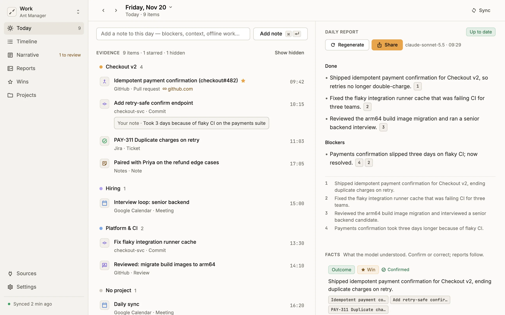

<p align="center">
  
</p>

<h1 align="center">Ant Manager</h1>

<p align="center">
  <b>Your work, quietly remembered.</b><br>
  A free, local-first desktop app that keeps a record of your work and turns it into cited reports.
</p>

<p align="center">
  <a href="https://ant-manager.thecodepapaya.dev/">Website</a> ·
  <a href="https://github.com/thecodepapaya/ant-manager/releases">Download</a> ·
  <a href="https://github.com/thecodepapaya/ant-manager/issues/new?template=bug_report.yml">Report a bug</a>
</p>

<p align="center">
  <picture>
    <source media="(prefers-color-scheme: dark)" srcset="web/assets/shots/today_dark@2x.webp">
    
  </picture>
</p>

## What it does

Most of what you do at work is small and easy to forget. Ant Manager collects it as you go, so you don't have to
narrate your work in real time.

- **Captures evidence** from local git, GitHub, GitLab, Jira, Linear, your calendars (Google, Apple, Outlook, ICS),
  meeting transcripts and quick notes.
- **Keeps a Narrative:** typed facts about your work, each one citing the evidence behind it.
- **Writes reports** (daily, weekly, monthly, quarterly) and a Wins log you can take into a review. Every claim
  links back to its source.

## Private by design

Your data stays in a local database on your machine. You choose the AI model: OpenRouter, OpenAI, Anthropic,
Gemini, or a local one through Ollama or LM Studio. No sign-up, no analytics, no scores; crash reports are opt-in. See
[PRIVACY.md](PRIVACY.md) and [PHILOSOPHY.md](PHILOSOPHY.md).

## Install

Download the latest build for **macOS**, **Windows** or **Linux** from
[Releases](https://github.com/thecodepapaya/ant-manager/releases).

> Builds are unsigned for now. On macOS, open the app once, then go to **System Settings → Privacy & Security →
> Open Anyway**. On Windows, choose **More info → Run anyway**.

## Build from source

Requires Flutter (Dart 3.14+) and `git`.

```sh
git clone https://github.com/thecodepapaya/ant-manager.git
cd ant-manager/app
flutter run -d macos   # or windows, linux
```

The repo is a Dart workspace: `app/` (Flutter shell), `packages/core` (pure Dart engine) and `packages/ui`
(design system). Design docs live in [docs/](docs/SPEC.md).

## License

[Apache 2.0](LICENSE)
