# LLD 02 — Entities & relationships

Step 2 of the low-level design. Agreed with the owner on 2026-11-18. Builds on [01-requirements.md](./01-requirements.md);
rationale in [../DECISIONS.md](../DECISIONS.md) (#55–#63).

## Overview

Rendered natively on GitHub. Storage split: **app database** = Profile, Provider, Model (shared across profiles,
see decision #64); **per-profile database** = everything else. Built-in templates ship in code; custom templates are per
profile. `DEPENDENCY` and `RECOMPUTE_QUEUE` are polymorphic (they reference any derived entity by type + id), so
they're drawn without relationship lines.

```mermaid
erDiagram
    PROFILE ||--o{ IDENTITY : "identifies user"
    PROFILE ||--o{ SOURCE : connects
    PROFILE ||--o{ EVIDENCE : owns
    PROFILE ||--o{ FACT : "narrative"
    PROFILE ||--o{ WORKSTREAM : has
    PROFILE ||--o{ PROJECT : has
    PROFILE ||--o{ CURATION_RULE : has
    PROFILE ||--o{ REPORT : has
    PROFILE ||--o{ TEMPLATE : "custom templates"
    PROFILE ||--o{ TASK_ROUTE : routes
    PROFILE ||--o{ JOB : schedules
    SOURCE ||--o{ SYNC_CURSOR : tracks
    SOURCE ||--o{ PAYLOAD : produces
    EVIDENCE ||--|{ PAYLOAD : contains
    PAYLOAD ||--|{ PAYLOAD_REVISION : history
    PAYLOAD ||--o{ ATTACHMENT : stores
    PAYLOAD ||--o{ ENRICHMENT : "derived from payload"
    EVIDENCE ||--o{ ENRICHMENT : "derived from evidence"
    PROJECT |o--o{ EVIDENCE : groups
    PROJECT |o--o{ WORKSTREAM : groups
    PROJECT |o--o{ FACT : groups
    WORKSTREAM |o--o{ FACT : threads
    FACT ||--|{ FACT_REVISION : history
    FACT ||--|{ CITATION : "supported by"
    PAYLOAD_REVISION ||--o{ CITATION : "cited at"
    TEMPLATE ||--o{ REPORT : renders
    REPORT ||--o{ REPORT_SNAPSHOT : versions
    PROVIDER ||--o{ MODEL : offers
    MODEL |o--o{ TASK_ROUTE : "assigned to"

    PROFILE {
        string id PK
        string name
        json schedule
    }
    IDENTITY {
        string id PK
        string kind "email, github_login, gitlab_user..."
        string value
    }
    SOURCE {
        string id PK
        string kind "github, google_calendar, git_repo, screenshot..."
        json config
        string credential_ref "keychain key"
        bool enabled
    }
    SYNC_CURSOR {
        string source_id FK
        string scope "repo, calendar..."
        string cursor
        datetime last_success_at
    }
    EVIDENCE {
        string id PK "ULID"
        datetime occurred_start
        datetime occurred_end
        string title
        string project_id FK
        bool starred
        bool hidden
        float importance
        string importance_set_by "model, user, rule"
    }
    PAYLOAD {
        string id PK
        string evidence_id FK
        string source_id FK "UK with external_id"
        string kind "commit, review, calendar, note, image"
        string external_id
        json content
        string content_hash
        int revision
        datetime tombstoned_at
    }
    PAYLOAD_REVISION {
        string payload_id FK
        int revision
        json content
        string content_hash
        string cause "sync, user, merge, split"
        datetime observed_at
    }
    ATTACHMENT {
        string id PK
        string payload_id FK
        string path
        string sha256
    }
    ENRICHMENT {
        string id PK
        string target_type "payload or evidence"
        string target_id
        string kind "image_description, summary..."
        string output
        string model_id
    }
    FACT {
        string id PK
        string type "Outcome, ProblemSolved, InvisibleWork, Hiccup, Decision, TimeAllocation"
        string statement
        json details
        date period_start
        date period_end
        string workstream_id FK
        string project_id FK
        float importance
        string origin "inferred, confirmed, user_edited, user_created"
        string review_state "ok, needs_review"
        string win_status "none, suggested, accepted, rejected"
        int revision
    }
    FACT_REVISION {
        string fact_id FK
        int revision
        string statement
        json details
        string changed_by "model, user"
        datetime changed_at
    }
    CITATION {
        string fact_id FK
        string payload_id FK
        int payload_revision
        string locator "quote, line or time range"
    }
    WORKSTREAM {
        string id PK
        string project_id FK
        string title
        string summary
        date span_start
        date span_end
    }
    PROJECT {
        string id PK
        string name
        string colour
        bool archived
    }
    CURATION_RULE {
        string id PK
        json match
        string action "hide, set_importance"
        float value
        int priority
    }
    REPORT {
        string id PK
        string period_kind "daily, weekly, monthly, quarterly, custom"
        date period_start
        date period_end
        string template_id FK
        bool locked
        string locked_snapshot_id FK
    }
    REPORT_SNAPSHOT {
        string id PK
        string report_id FK
        int version
        string content "markdown + citation markers"
        string model_id
        string style_instruction
        datetime generated_at
    }
    TEMPLATE {
        string id PK
        string name
        string prompt
        bool built_in
        int version
    }
    PROVIDER {
        string id PK
        string kind "openrouter, openai, anthropic, gemini, custom"
        string base_url
        string protocol "openai, ollama, native"
        string credential_ref
        string network_class "private, remote"
    }
    MODEL {
        string id PK
        string provider_id FK
        string model_name
        json capabilities "vision, context_length"
    }
    TASK_ROUTE {
        string task PK "default, importance, fact_extraction, report..."
        string model_id FK "null = inherit default"
    }
    JOB {
        string id PK
        string kind "sync, enrich, score, extract, report, backup"
        json args
        string state
        int attempts
        datetime run_after
    }
    DEPENDENCY {
        string dependent_type
        string dependent_id
        int dependent_revision
        string input_type
        string input_id
        int input_revision
    }
    RECOMPUTE_QUEUE {
        string entity_type
        string entity_id
        string reason
        datetime enqueued_at
    }
```

## Entities

### Profile & identity
| Entity | Purpose | Key attributes |
|---|---|---|
| **Profile** | Top-level scope (e.g. Work, Side projects). Everything below belongs to one profile. | id, name, colour, schedule settings |
| **Identity** | Decides which evidence is "mine". | profile, kind (email / github login / gitlab username / jira account…), value |

### Capture
| Entity | Purpose | Key attributes |
|---|---|---|
| **Source** | A connector instance: where payloads come from. | id, profile, kind (github, github_enterprise, gitlab, google_calendar, apple_calendar, outlook, ics, git_repo, screenshot_capture, manual_note, linear, jira, transcript…), config (JSON), credential ref (keychain key), enabled |
| **SyncCursor** | Incremental sync position per source (and sub-scope, e.g. per repo or calendar). | source, scope, cursor (opaque), last_success_at, last_error |
| **Evidence** | A *moment of work*. Usually holds one payload; sometimes several (see grouping). | id (ULID), profile, occurred_start, occurred_end?, title, project?, starred, hidden, **importance** {score, reason, set_by: model\|user\|rule}, created_at, updated_at |
| **Payload** | One typed piece of content inside an evidence item, from exactly one source. | id, evidence, **kind**, source, **external_id**, content (typed JSON per kind), **content_hash**, **revision**, tombstoned_at? |
| **PayloadRevision** | Append-only change log: what each payload looked like at each revision. | payload, revision, content, content_hash, observed_at, cause (sync \| user \| merge \| split) |
| **Attachment** | Binary content (screenshots) stored on disk, referenced by a payload. | id, payload, path, mime, sha256, size |
| **Enrichment** | Model-derived data on top of raw content: image description, transcript summary, combined summary. Never overwrites raw payloads. | id, target (payload \| evidence), kind, output, model, created_at (inputs recorded via Dependency) |

### Narrative
| Entity | Purpose | Key attributes |
|---|---|---|
| **Fact** | One typed, cited statement about the work. The Narrative is the set of facts in a profile. | id, profile, **type** (Outcome, Problem solved, Invisible work, Hiccup, Decision, Time allocation), statement, details (typed JSON, e.g. minutes + measured/estimated for time), period start/end, workstream?, project?, **importance**, **origin** (inferred \| confirmed \| user-edited \| user-created), **review_state** (ok \| needs_review), **win_status** (none \| suggested \| accepted \| rejected), revision |
| **FactRevision** | Append-only history of a fact: every model re-extraction and every user correction. | fact, revision, statement, details, origin, changed_by (model \| user), changed_at |
| **Citation** | Links a fact to the exact payload revision that supports it. | fact, payload, payload_revision, locator? (quote, line or time range) |
| **Workstream** | A thread of related work over time (the "timeline" view). Facts belong to it. | id, profile, project?, title, summary (derived), span start/end |
| **Project** | User-level grouping of evidence, facts and workstreams. | id, profile, name, colour, archived |
| **CurationRule** | Bulk user overrides: hide (weight 0) or re-weight matching evidence. | id, profile, match (source kind, title pattern, repo, attendee count…), action (hide \| set_importance), value, priority, enabled |

### Outputs
| Entity | Purpose | Key attributes |
|---|---|---|
| **Report** | A period report: daily, weekly, monthly, quarterly or custom. Read-only. | id, profile, period_kind, period start/end, template, **locked**, locked_snapshot? |
| **ReportSnapshot** | One rendered version of a report. Immutable. Facts used are recorded via Dependency. | id, report, version, content (Markdown + citation markers), model, style_instruction?, generated_at |
| **Template** | How a report is structured and worded (Standup, Manager update, Brag doc…). Never changes facts. | id, profile?, name, period kinds, prompt, built_in, version |

### Models
| Entity | Purpose | Key attributes |
|---|---|---|
| **Provider** | An AI endpoint: OpenRouter, OpenAI, Anthropic, Gemini, or a custom endpoint (local, LAN, remote). | id, kind, base_url, protocol (openai \| ollama \| native), credential ref, network class (private \| remote), tls options |
| **Model** | A model offered by a provider. | provider, model_id, capabilities (vision, context length), pricing? |
| **TaskRoute** | Which model handles a task. The `default` route is the global model; other tasks inherit unless overridden. | profile, task (default, importance, enrichment.image, enrichment.transcript, fact_extraction, report, win_suggestion…), model? (null = inherit default) |

### Background & staleness machinery
| Entity | Purpose | Key attributes |
|---|---|---|
| **Job** | Durable background work: sync, enrichment, importance scoring, fact extraction, report generation, backup. Survives restarts. | id, kind, args, state, attempts, run_after, last_error |
| **Dependency** | Records exactly which input revisions a derived thing was built from. | dependent (type, id, revision), input (type, id, revision) |
| **RecomputeQueue** | Dirty entries written **by SQLite triggers in the same transaction** as the change that caused them. | entity (type, id), reason, enqueued_at |

## Key invariants

1. **Payload identity:** `(source, external_id)` is unique. A sync updates only its own payload and never touches other payloads on the same evidence (e.g. the user's note on a meeting).
2. **Revisions only on meaningful change:** a new PayloadRevision is written only when `content_hash` changes, not on a re-sync or a timestamp touch.
3. **No deletion of history:** upstream deletions **tombstone** the payload. Evidence survives while it has any live payload. Revisions are append-only.
4. **Every fact has ≥ 1 citation**, each pinned to a payload revision. Citations target payloads, not evidence.
5. **Staleness is computed, never set by hand:** a derived item is stale iff any recorded input revision ≠ the current revision. Triggers enqueue recompute work atomically with the change, so an app exit can't lose it. Staleness is transitive: payload → enrichment → fact → report.
6. **Recompute policy:** enrichments, importance and facts recompute **eagerly** (background, debounced). Reports recompute **lazily** (when opened, on schedule, or on demand) and show "out of date" until then.
7. **User-touched data is never overwritten by the model:** fact origin `confirmed` / `user-edited` / `user-created`, any `win_status` the user set, and importance set by a user or rule. If a confirmed fact's evidence changes, the fact gets `review_state = needs_review` instead of being re-extracted.
8. **Locked reports are pinned snapshots:** never regenerated, shown with "facts changed since lock" when stale, and unlockable.
9. **Wins are a view:** facts with `type = Outcome` and `win_status = accepted`. Starring an evidence item creates or upgrades such a fact (user-set).

## Grouping payloads into evidence

1:1 is the norm. Grouping is rare and never fuzzy.

- **Automatic, exact identity only:** the same meeting from two calendars (same iCal UID); the same commit from local git and a hosting API (same SHA).
- **Manual:** drag a screenshot or note onto an existing evidence item.
- **Suggested:** a quick capture during a meeting offers to attach to that meeting (time overlap). The user confirms.
- **Split:** "detach" moves a payload into its own new evidence. Citations stay valid because they target payloads.

## Importance

- **Scored by the model**, batched and cached, re-scored only when payloads change. Unscored evidence gets a neutral default.
- **Overridden by the user:** per item (star = boost, hide = 0) or in bulk with **CurationRules** ("treat *Daily sync* as low", "hide *Lunch*").
- Precedence: user per-item > rule (by priority) > model.
- **Used for space allocation:** the prompt budget for facts and reports is allocated by importance, so a design handoff gets more room than a status sync.

## Resolved during review

- **Global vs per-profile:** Providers and Models are **global** (one OpenRouter key or LAN endpoint serves every
  profile; credentials in the keychain once). TaskRoutes are **per profile**, so each profile picks its own default and overrides.
- **Workstream is an entity** (a thread that facts belong to), not a fact type. Refines DECISIONS #48.
- **Regenerate with a style instruction** ("shorter", "less jargon") is allowed. It changes wording only, never facts,
  and is stored on the ReportSnapshot.
